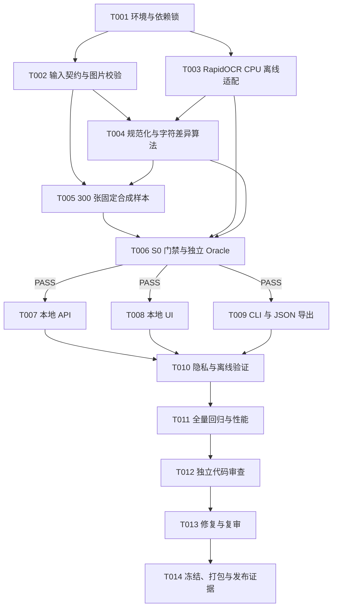

# P033 字证 TextProof｜实施计划书

> **计划版本：** `1.0.0`  
> **PROJECT_ID：** `P033`  
> **SLUG：** `textproof`  
> **日期：** `2026-11-25`  
> **状态：** `READY_FOR_DISPATCH / NO_CODE_BUILT`  
> **预算：** `88h`（任务工时合计，含独立审查与发布）  
> **唯一产品契约：** `PROJECT_BOOK.md` §0–§16  
> **总控：** Muse（调度、门禁、核验、归档；不编写业务代码或测试）

---

## 0. 执行摘要与不可变决定

### 0.1 一句话产品定义

AI 负责画图，TextProof 负责逐字证明图里的文字是否符合用户原本提供的内容。

### 0.2 绝对约束

1. 总预算严格为 88 小时；任务表合计必须等于 88h。
2. 零真人：不得招募、访谈或测试真人；不得使用真实用户图片；不得使用真实用户数据集；所有测试图像由脚本合成。
3. 项目自有代码采用 MIT；RapidOCR、OCR 模型、字典、字体和依赖分别遵守其上游许可证，必须生成 `THIRD_PARTY_NOTICES.md`。
4. 产品离线、本地、CPU-only；禁止 GPU、收费 API、LLM、云 OCR、遥测、外部图片服务和外网模型下载。
5. 输入输出契约以 `PROJECT_BOOK.md` §5 为唯一权威；字符归一化、错误枚举、坐标和阈值以 §4、§7 为权威。
6. S0 门禁必须按 `PROJECT_BOOK.md` §8 执行；未通过不得启动 T007–T014；不得删样本、改分母、降低指标或把失败案例改为非阻断。
7. 所有代码、修复、独立审查和集成任务均由 Muse 调度的既有免费模型平台执行；每张任务卡开启全新会话。Muse 不编写业务代码或测试。
8. 不同任务不得并发修改相同文件；任务先验收、后合并。构建者与独立审查者尽可能使用不同模型和独立会话。

### 0.3 版本与交付身份

- 产品版本初始目标：`0.1.0`。
- 规格版本：`1.0.0`。
- JSON schema：`textproof.report/v1`。
- 当前规格状态：`SPEC_FROZEN / NOT_IMPLEMENTED`。
- 任何契约变化必须走 ADR 和规格版本升级；未经批准不允许施工 Agent“自行合理化”。

---

## 1. 阶段门槛

| 阶段 | 任务 | 交付 | 退出门槛 |
|---|---|---|---|
| S0 环境、契约、OCR、比较核心、固定样本与独立 Oracle | T001–T006 | 可运行 OCR 核心、300 张合成样本、固定预言、独立比较 Oracle、S0 报告 | 完整满足 `PROJECT_BOOK.md` §8.1–§8.4；S0 PASS 才解锁后续 |
| S1 本地产品入口 | T007–T010 | FastAPI、UI、CLI、JSON、隐私和离线约束 | FR-01–FR-11 全部可运行；API / UI / CLI 同结果 |
| S2 全量回归与独立审查 | T011–T013 | 回归报告、性能报告、独立审查、修复记录 | 测试通过；P0/P1 清零；S0 不回退 |
| S3 冻结与发布交接 | T014 | 源码包、wheelhouse、证据索引、哈希、Review Pack | `verify_release.py` PASS；覆盖清单完整；提交 ChatGPT 独立终审 |

**S0 是硬门。** S0 未通过时，T007–T014 全部保持 `BLOCKED`，不得以“先做 UI”绕过。

---

## 2. 依赖图与集成顺序



### 2.1 集成规则

- T001–T006 可按文件归属分支执行；T004 等待 T002、T003 接口冻结。
- T005 依赖 T002 的输入约束与 T004 的报告契约。
- T006 集成生产实现、独立 Oracle 和固定 fixture；S0 PASS 后才合并主分支。
- T007–T009 分属 API、UI、CLI 文件域，可并行施工，但各自依赖已合并 S0 commit。
- T010 统一集成并进行隐私 / 网络边界检查。
- T011 在集成树上运行完整回归。
- T012 使用全新会话与冻结 commit 做独立审查；审查者不得修改代码。
- T013 由新的修复会话处理 T012 问题；修复后由独立复审会话验证。
- T014 只在修复与复审通过后执行冻结和发布打包。

---

## 3. 任务总表（工时合计 88h）

| TASK_ID | 任务 | 工时 | 依赖 | 主要输出 |
|---|---|---:|---|---|
| T001 | 环境探测、Python 与依赖锁 | 4h | 无 | `ENVIRONMENT.md`、`requirements.lock` |
| T002 | 输入契约、图片解码与校验 | 5h | T001 | `contracts.py`、`image_loader.py` |
| T003 | RapidOCR CPU 适配与离线模型资产 | 8h | T001 | OCR adapter、模型资产、模型哈希与 NOTICE |
| T004 | 规范化、行对齐、加权编辑距离与错误分类 | 8h | T002、T003 接口 | `src/textproof/core/` |
| T005 | 300 张合成 fixture 与固定预期 | 7h | T002、T004 | fixture、generator、manifest |
| T006 | S0 门禁、独立 Oracle 与独立复核脚本 | 4h | T003–T005 | Oracle、`verify_s0.py`、S0 报告 |
| T007 | FastAPI 本地 API 与健康检查 | 10h | S0 PASS | `api/`、接口测试 |
| T008 | 本地 Web UI 与错误框交互 | 8h | S0 PASS、T007 契约 | `ui/`、E2E |
| T009 | CLI、JSON schema 与导出 | 6h | S0 PASS | `cli.py`、JSON schema |
| T010 | 隐私、内存生命周期与离线安全 | 5h | T007–T009 | privacy tests、network tests |
| T011 | 全量回归、300 样本指标与性能报告 | 7h | T010 | test logs、metrics report |
| T012 | 独立代码审查 | 4h | T011 | `REVIEW_FINDINGS.md` |
| T013 | 修复、复测与独立复审 | 6h | T012 | fix commits、closure matrix |
| T014 | 发布打包、哈希、Review Pack 与归档 | 6h | T013 PASS | release artifacts、review index |

**工时校验：** 4+5+8+8+7+4+10+8+6+5+7+4+6+6 = **88h**。  
任何新增工作必须从现有任务范围内调整并经 Muse 记录；不得默默扩大预算。


---

## 4. 原子任务卡

### T001 — 环境探测、Python 与依赖锁

- **工时：** 4h
- **目标：** 确认实际施工 OS、Python、CPU、内存、磁盘与依赖安装能力；冻结依赖版本。
- **输入：** 本计划、`PROJECT_BOOK.md` §6、当前 VM。
- **输出：** `ENVIRONMENT.md`、`pyproject.toml`、`requirements.lock`、`T001_RESULT.md`。
- **文件所有权：** `pyproject.toml`、`requirements.lock`、`scripts/env_probe.py`、`ENVIRONMENT.md`。
- **禁止修改：** 产品契约、JSON schema、核心算法、OCR 模型文件。
- **执行命令：**

```bash
python --version
python -m pip --version
git --version
python -c "import platform; print(platform.platform()); print(platform.machine())"
python -c "import os; print(os.cpu_count())"
```

- **验收标准：**
  1. Python 3.12.x 可用；若不满足，使用 Muse 已有环境切换方式，不购买新账号或软件。
  2. 记录 OS、架构、CPU 核数、内存、可用磁盘、Python / pip / Git 版本。
  3. 依赖解析成功；锁文件中每个直接依赖及传递依赖均有精确版本和哈希。
  4. 明确安装的是 `onnxruntime` CPU 包，不是 `onnxruntime-gpu`。
  5. 依赖版本与 `PROJECT_BOOK.md` §6.2 一致；任何偏差写入结果报告。
- **证据：** 原始命令日志、环境摘要、锁文件、锁文件 SHA-256。
- **完成定义：** 独立新会话审查锁文件可重建；Muse 运行 `pip install --require-hashes` 安装验证通过。
- **失败回退：** 若 Python 3.12 / RapidOCR 兼容性无法建立，停止后续任务并提交环境阻断，不得擅自更换 OCR 产品契约。

### T002 — 输入契约、图片解码与校验

- **工时：** 5h
- **目标：** 实现 `PROJECT_BOOK.md` §4.2 的图片与期望文本输入校验。
- **输入：** T001 commit、项目书 §4.2、§5。
- **输出：** `src/textproof/contracts.py`、`src/textproof/io/image_loader.py`、`tests/unit/test_image_loader.py`。
- **文件所有权：** `contracts.py`、`io/image_loader.py` 及对应单元测试。
- **禁止修改：** §5 schema 字段、§4.2 上限、OCR 适配器。
- **验收标准：**
  1. 只接受 PNG/JPEG/WebP；通过魔数检查，不依赖扩展名。
  2. 25 MiB、8192 px、40MP 三项边界分别有正反测试。
  3. 动画 WebP、损坏文件、扩展名伪装、超像素和解码异常均 fail-closed。
  4. 正确应用 EXIF orientation，输出宽高和坐标基准符合 §5。
  5. 期望文本 5,000 码点 / 100 行边界通过测试；空白输入拒绝。
  6. 不把绝对路径、EXIF 用户备注或地理位置写入报告。
- **验收命令：** `python -m pytest tests/unit/test_image_loader.py -q`
- **证据：** 测试日志、输入边界矩阵、接口样例 JSON。
- **完成定义：** 所有输入错误使用统一错误码；没有任意路径写入。
- **失败回退：** 不放宽输入上限；不支持的格式返回明确 `INVALID_INPUT`。

### T003 — RapidOCR CPU 适配与离线模型资产

- **工时：** 8h
- **目标：** 接入 RapidOCR `3.10.0`，使用 ONNX Runtime CPU provider，固定模型和字典本地路径。
- **输入：** T001 commit、`PROJECT_BOOK.md` §6.2、§9、§10。
- **输出：** `src/textproof/ocr/rapidocr_adapter.py`、`assets/ocr/`、`assets/ocr/SHA256SUMS.txt`、`THIRD_PARTY_NOTICES.md`、`tests/integration/test_ocr_adapter.py`。
- **文件所有权：** OCR adapter、模型资产、OCR 资产说明与哈希。
- **禁止修改：** 比较算法、报告 schema、UI、外部网络白名单。
- **验收标准：**
  1. RapidOCR 精确版本为 `3.10.0`；依赖通过 T001 锁文件固定。
  2. 默认模型路由按官方文档确认并冻结；优先使用 PP-OCRv6 small 检测 / 识别与 PP-OCRv4 mobile 方向分类。
  3. 模型、字典全部位于本地资产路径；记录来源 URL、许可证、版本、SHA-256。
  4. 启动时不得触发模型下载；删除或断开外网后仍可完成 OCR。
  5. ONNX Runtime 实际 provider 仅 `CPUExecutionProvider`；不得加载 GPU provider。
  6. 返回结构至少包含文本、置信度、bbox、quad 和原始顺序。
  7. 字典许可单独核实；不得因为模型为 Apache-2.0 就推断字典自动同许可。
- **验收命令：** `python -m pytest tests/integration/test_ocr_adapter.py -q`
- **证据：** 模型资产 SHA 清单、provider 输出、离线运行日志、许可证来源。
- **完成定义：** 在网络封锁环境内，对固定清晰中英数字图片能输出可用文本框。
- **失败回退：** 不允许运行时联网下载；若模型资产不能本地化，T003 FAIL，停止 S0。

### T004 — 规范化、行对齐、加权编辑距离与错误分类

- **工时：** 8h
- **目标：** 实现 `PROJECT_BOOK.md` §4.3–§4.6、§7 的冻结算法。
- **输入：** T002 / T003 接口、项目书 §4.3–§4.6、§7。
- **输出：** `src/textproof/core/normalize.py`、`line_order.py`、`align_lines.py`、`weighted_edit.py`、`classify.py`、`report.py`。
- **文件所有权：** `src/textproof/core/`。
- **禁止修改：** 错误枚举、权重、gap penalty、歧义 margin、坐标语义、schema。
- **验收标准：**
  1. NFC、全角 ASCII 映射、空白处理与大小写敏感规则逐条符合 §4.3。
  2. 行序列对齐 gap penalty 固定为 `0.35`；歧义 margin 固定为 `0.05`；高代价行配对阈值固定为 `0.70`。
  3. 字符权重逐项符合 §4.5；视觉混淆对即使低权重也必须报告差异。
  4. 数字到数字替换分类为 `NUMERIC_CHANGE`。
  5. 字符 span 为规范化后码点索引，左闭右开。
  6. 缺失整行无 bbox 时输出 `null`，不得伪造坐标。
  7. 相同输入在重复运行中产生相同 JSON 语义结果。
- **验收命令：** `python -m pytest tests/unit/test_core -q`
- **证据：** 每个算法分支的 golden tests、边界矩阵、固定输入输出。
- **完成定义：** 生产比较核心不依赖 OCR 或 UI，可用固定 OCR line records 单独测试。
- **失败回退：** 算法与 §4 / §7 冲突时以项目书为准，提交 ADR，不得由施工者自行改权重。

### T005 — 300 张合成 fixture 与固定预期

- **工时：** 7h
- **目标：** 生成 `PROJECT_BOOK.md` §8.1 / §8.2 的固定合成测试集。
- **输入：** T002、T004、Noto Sans SC OFL 字体文件。
- **输出：** `scripts/generate_fixtures.py`、`tests/fixtures/s0/`、`manifest.json`、`expected_output.json`、字体来源与 SHA。
- **文件所有权：** `scripts/generate_fixtures.py`、`tests/fixtures/s0/`、fixture manifest。
- **禁止修改：** 项目书的 300 样本数量、100/200 分组、类别数量与阈值。
- **验收标准：**
  1. 共 300 张唯一静态图片：100 clean、70 substitution、70 omission、60 numeric change。
  2. 所有图片由固定生成器、固定参数、固定字体和固定 seed 生成。
  3. 每张图片有唯一 ID、SHA-256、expected text、mutation label、target region 和 expected report。
  4. 四个 `TP-S0-*` 固定案例的期望文本、实际绘制文本、错误类型、字符片段和 span 完全符合 `PROJECT_BOOK.md` §8.1。
  5. 盲测子集不少于 60 张，单独保存 ID 列表与 SHA-256；不得在验收前用盲测子集反复调参。
  6. 测试样本中不得混入网络图片、用户图片、真实人物照片或真人标注。
- **验收命令：** `python scripts/generate_fixtures.py --verify-manifest tests/fixtures/s0/manifest.json`
- **证据：** 300 文件清单、manifest、字体许可证、fixture SHA-256、生成日志。
- **完成定义：** 连续两次生成的图片 SHA 清单完全一致。
- **失败回退：** fixture 不可复现则 S0 不得启动；不得以临时随机图替代。

### T006 — S0 门禁、独立 Oracle 与独立复核

- **工时：** 4h
- **目标：** 建立可独立复核的 S0，不把“门禁脚本自己 PASS”当作唯一证据。
- **输入：** T003–T005 commit、`PROJECT_BOOK.md` §8。
- **输出：** `oracle/reference_compare.py`、`scripts/verify_s0.py`、`scripts/independent_verify.py`、`S0_REPORT.md`。
- **文件所有权：** `oracle/`、`scripts/verify_s0.py`、`scripts/independent_verify.py`、`S0_REPORT.md`。
- **禁止修改：** 300 样本 manifest、预期输出、指标阈值、生产比较算法。
- **验收标准：**
  1. Oracle 不得 import 生产比较模块；由独立会话实现不同代码路径。（规格锚点：`PROJECT_BOOK.md` §8.4）
  2. 生产模块与 Oracle 在固定字符 / 行 fixture 上 100% parity。（规格锚点：`PROJECT_BOOK.md` §8.4）
  3. 四个固定案例逐项核对 §8.1 的类型、文本片段、span、bbox 规则和 verdict。（规格锚点：`PROJECT_BOOK.md` §8.1）
  4. 300 样本检测召回率 ≥95%；替换 / 缺失 / 数字变化每类 ≥90%。（规格锚点：`PROJECT_BOOK.md` §8.2–§8.3）
  5. 100 张 clean 图片误报率 ≤8%。（规格锚点：`PROJECT_BOOK.md` §8.2–§8.3）
  6. JSON schema 合法率 100%；OCR CER 独立报告，不得替代检错召回率。（规格锚点：`PROJECT_BOOK.md` §5.1–§5.3、§8.3）
  7. 网络访问 0；ONNX Runtime provider 仅 CPU。（规格锚点：`PROJECT_BOOK.md` §6.1–§6.2、§8.3、§9）
  8. `independent_verify.py` 必须从原始 PNG、manifest 和 expected output 独立复核 `TP-S0-ZH-001`；不能只调用 `verify_s0.py`。（规格锚点：`PROJECT_BOOK.md` §8.1、§8.4）
  9. S0 报告记录环境、版本、commit、所有 SHA、命令、退出码、指标、未执行项。（规格锚点：`PROJECT_BOOK.md` §8.4、§11.1）
- **验收命令：**

```bash
python -m pytest -q
python scripts/verify_s0.py --manifest tests/fixtures/s0/manifest.json
python scripts/independent_verify.py --case TP-S0-ZH-001
```

- **证据：** `S0_REPORT.md`、独立 Oracle 输出、独立复核日志、300 样本指标、网络封锁日志。
- **完成定义：** 所有硬门 PASS；Muse 复核证据覆盖；S0 commit 冻结并解锁 T007。
- **失败回退：** 任一硬门失败即 `S0_FAIL`；T007–T014 BLOCKED；不得降低指标、删除 fixture 或修改分母。


### T007 — FastAPI 本地 API 与健康检查

- **工时：** 10h
- **目标：** 实现本地 HTTP 接口并调用已通过 S0 的核心。
- **输入：** S0 PASS commit、`PROJECT_BOOK.md` §5.5、§6。
- **输出：** `src/textproof/api/`、API schema tests、`API_CONTRACT.md`。
- **文件所有权：** `src/textproof/api/`。
- **禁止修改：** 核心算法、JSON schema、OCR 模型路径、隐私约束。
- **验收标准：**
  1. `GET /api/v1/health` 与 `/version` 正常。
  2. `POST /api/v1/check` 接收 `image_mime`、`image_base64`、`expected_text`，返回 `textproof.report/v1`。
  3. 绑定地址固定为 `127.0.0.1`；公网 IP / `0.0.0.0` 监听必须拒绝。
  4. 图片字节只在内存中解码；请求结束后无跨请求缓存。
  5. 超限输入、错误 MIME、非法 base64、空文本和 OCR 失败返回明确错误码。
  6. API 与核心 CLI 对同一 fixture 的 JSON 语义结果一致。
- **验收命令：** `python -m pytest tests/integration/test_api.py -q`
- **证据：** API 请求 / 响应 fixture、loopback 监听证明、错误输入测试日志。
- **完成定义：** 本机调用成功，外部设备不能直接访问。
- **失败回退：** API 不得为方便调试而开放公网监听或启用外部 CORS。

### T008 — 本地 Web UI 与错误框交互

- **工时：** 8h
- **目标：** 完成项目书 §3.2 的单页本地界面。
- **输入：** T007 API、S0 PASS commit、`PROJECT_BOOK.md` §3.2。
- **输出：** `src/textproof/ui/index.html`、`app.js`、`style.css`、E2E tests。
- **文件所有权：** `src/textproof/ui/` 与 UI E2E 测试。
- **禁止修改：** API schema、算法阈值、外部 CDN / 字体 / JS 依赖。
- **验收标准：**
  1. 上传图片、编辑期望文本、开始核对、重新核对、下载 JSON、清除均可操作。
  2. 图片预览、OCR 行框和错误清单能联动。
  3. 选中错误项后高亮其 OCR 行 bbox；缺失整行显示“无可定位 OCR 框”。
  4. `REVIEW_REQUIRED`、低置信度和 `OCR_FAILED` 的文案明确，不误导为确定错误。
  5. 无 CDN、外链字体、第三方脚本和外部图片 URL。
  6. 清除时撤销 object URL，清空浏览器内存状态，不写 localStorage。
- **验收命令：** `python -m pytest tests/e2e -q`
- **证据：** 合成图片 UI 截图、E2E 日志、外部请求拦截日志。
- **完成定义：** 主流程从上传到 JSON 导出完整通过。
- **失败回退：** 不用在线 OCR 或第三方前端库绕过离线约束。

### T009 — CLI、JSON schema 与导出

- **工时：** 6h
- **目标：** 完成 CLI 与统一 JSON 输出。
- **输入：** S0 PASS commit、`PROJECT_BOOK.md` §5.4–§5.5。
- **输出：** `src/textproof/cli.py`、`schemas/textproof.report.v1.schema.json`、CLI tests。
- **文件所有权：** CLI、schema 文件与 CLI 测试。
- **禁止修改：** §5 字段、错误类型、坐标系、退出码。
- **验收标准：**
  1. `textproof check`、`serve`、`verify-s0`、`version` 四条命令可用。
  2. `check` 输出与 API 相同 JSON schema。
  3. 退出码 0–5 与 `PROJECT_BOOK.md` §5.5 一致。
  4. JSON 导出不包含图片 base64、绝对路径或用户 home path。
  5. 所有报告通过 JSON Schema 校验。
- **验收命令：** `python -m pytest tests/integration/test_cli.py -q`
- **证据：** 命令日志、JSON 样例、schema validation report。
- **完成定义：** 无浏览器也可完成图片核对和 JSON 导出。
- **失败回退：** 不创建第二套 CLI-only 错误算法。

### T010 — 隐私、内存生命周期与离线安全

- **工时：** 5h
- **目标：** 验证 `PROJECT_BOOK.md` §9 的隐私与安全承诺。
- **输入：** T007–T009 集成 commit、§9。
- **输出：** `tests/privacy/`、`tests/offline/`、`PRIVACY_TEST_REPORT.md`。
- **文件所有权：** 隐私与离线测试、报告。
- **禁止修改：** 输入输出契约、算法、模型许可。
- **验收标准：**
  1. TextProof 发起外部网络请求数为 0。
  2. OCR 模型、字典、JS、CSS 和字体均来自本地文件。
  3. 图片、期望文本和 OCR 全文不写日志、不写数据库、不写 localStorage。
  4. API 不把图片写入持久临时文件；如底层 multipart / buffer 默认会落盘，必须改为内存处理并以测试证明。
  5. 服务端 stateless；请求完成后不保留图片和报告缓存。
  6. 清除 UI 后图片 object URL 被 revoke，报告和文本不可再从 UI 访问。
  7. loopback 外部监听拒绝；输入格式、大小、像素数和解码异常 fail-closed。
- **验收命令：** `python -m pytest tests/privacy tests/offline -q`
- **证据：** socket / HTTP 拦截日志、文件系统写入观察、localStorage 检查、清除操作 E2E。
- **完成定义：** §9 逐项通过；无法证明的项明确登记。
- **失败回退：** 不得用“本机运行”作为无需测试的理由。

### T011 — 全量回归、300 样本指标与性能报告

- **工时：** 7h
- **目标：** 在完整产品上重跑冻结测试集与指标。
- **输入：** T007–T010 集成 commit、S0 fixtures。
- **输出：** `FULL_TEST_REPORT.md`、`METRICS_REPORT.json`、`PERFORMANCE_REPORT.md`。
- **文件所有权：** 全量测试驱动、报告和性能脚本。
- **禁止修改：** fixture、分母、S0 阈值和核心契约。
- **验收标准：**
  1. 单元 / 集成 / API / CLI / UI / privacy / offline 全量测试通过。
  2. 300 样本数量和 SHA 与 S0 manifest 一致。
  3. 召回率、分类型召回率、clean FPR、OCR CER 分开报告。
  4. 预热后 1920×1080 图片 30 次测量 P95 ≤5 秒；报告 CPU、OS、Python、模型和依赖版本。
  5. API、UI、CLI 同一输入输出 JSON 语义一致。
  6. S0 独立 Oracle parity 仍为 100%。
- **验收命令：** `python -m pytest -q`、`python scripts/verify_s0.py --manifest tests/fixtures/s0/manifest.json`
- **证据：** 原始日志、退出码、指标 JSON、性能原始测量数据。
- **完成定义：** 所有门槛满足；不得删除历史失败日志。
- **失败回退：** 真实失败转入 T013 修复，不允许在本任务中改测试预期。

### T012 — 独立代码审查

- **工时：** 4h
- **目标：** 由独立模型 / 独立会话审查冻结候选 commit。
- **输入：** T011 commit、`REVIEW_INDEX.md` 草稿、项目书与计划书。
- **输出：** `REVIEW_FINDINGS.md`、覆盖表、复现脚本或复现说明。
- **文件所有权：** 只写 `review/`；审查者不修改生产源码。
- **禁止修改：** `src/`、测试预期、manifest、release 文件。
- **验收标准：**
  1. 核对 §4–§9 契约与实现一致。
  2. 核查 OCR 模型 / 字典 / 字体许可与离线资产哈希。
  3. 独立复核 `TP-S0-ZH-001` 原始 PNG、期望文本、实际 OCR 结果、错误类型和坐标。
  4. 审查 JSON schema、CLI exit code、API / UI / CLI 一致性。
  5. 核查日志、缓存、临时文件、网络访问和 loopback 绑定。
  6. 每个 finding 标明文件路径、行号、影响、复现命令、严重级别。
  7. 审查覆盖率写为已实际读取文件数 / 应读取文件数；仅看文件名不计读取。
- **验收命令：** `python scripts/verify_review_pack.py review/REVIEW_INDEX.md`
- **证据：** 独立审查报告、文件覆盖表、复现日志。
- **完成定义：** 所有核心文件有明确审查结论；审查者未修改源码。
- **失败回退：** 覆盖不完整或关键证据无法读取，标记 `REVIEW_INCOMPLETE`，不得进入 T014。

### T013 — 修复、复测与独立复审

- **工时：** 6h
- **目标：** 关闭 T012 的 P0/P1，复测修复并由不同会话独立复审。
- **输入：** T012 findings、冻结候选 commit、相关测试证据。
- **输出：** 修复 commits、`FIX_MATRIX.md`、复审报告。
- **文件所有权：** 按 finding 拆分独立 worktree；一个修复任务只改其声明文件。
- **禁止修改：** 未被 finding 涉及的文件、S0 门槛、输入输出契约。
- **验收标准：**
  1. 每项 finding 对应 TASK_ID、根因、修复 commit、新增回归测试和结果。
  2. P0/P1 全部关闭；P2 逐项修复或记录为非阻断并说明影响。
  3. 修复后完整 pytest、S0、离线和隐私测试通过。
  4. 复审者为新的独立会话，不是原修复者自评。
  5. 不允许为通过测试而更改 fixture 原图、manifest 或阈值。
- **验收命令：** `python -m pytest -q`、`python scripts/verify_s0.py --manifest tests/fixtures/s0/manifest.json`、`python scripts/verify_release.py --preflight`
- **证据：** finding closure matrix、diff、测试日志、复审签署报告。
- **完成定义：** P0/P1 = 0，复审 PASS。
- **失败回退：** 超出 6h 或仍有 P0/P1 时，报告阻断；不得挪用未批准预算或进入发布。

### T014 — 冻结、打包与发布证据

- **工时：** 6h
- **目标：** 生成可独立重建的源码、离线安装包、证据索引和发布候选。
- **输入：** T013 PASS commit、四份规格文件、全部测试与复审报告。
- **输出：** `source.zip`、wheel、`wheelhouse/`、`SHA256SUMS.txt`、`RELEASE_MANIFEST.json`、`REVIEW_INDEX.md`、`REVIEW_PACK_XX.md`、`verify_release.py` 日志。
- **文件所有权：** `release/`、`review/REVIEW_INDEX.md`、`review/REVIEW_PACK_XX.md`、README / release docs。
- **禁止修改：** 冻结代码和规格契约；如发现代码问题回到 T013。
- **验收标准：**
  1. `source.zip` 与冻结 Git commit 逐文件一致。
  2. wheel 可安装；离线 wheelhouse 在无网络环境完成安装和运行。
  3. 模型、字典、字体及第三方依赖均有来源、版本、SHA-256 和许可证记录。
  4. 300 fixture、manifest、盲测清单和 S0 报告均包含在 source / review 交付物中。
  5. `SHA256SUMS.txt` 覆盖所有发布文件；独立重算全部哈希一致。
  6. DOCX 与 Markdown 的章节、表格、示例和字段同步；不缺节、不残留占位符。
  7. `REVIEW_INDEX.md` / `REVIEW_PACK_XX.md` 锚定最终冻结 commit；覆盖表可追踪到实际文件。
  8. `verify_release.py` 从干净目录运行 PASS。
  9. Git bundle / commit、源码包、wheel、测试日志和截图之间的版本身份一致。
- **验收命令：** `python scripts/verify_release.py`
- **证据：** release manifest、hash log、clean install log、offline run log、Review Pack、最终截图。
- **完成定义：** 交付结构齐全、哈希可复核、版本冻结，等待 ChatGPT 独立终审。
- **失败回退：** 任一 hash、包内容或审查索引不一致，停止提交终审；修复发布元数据并重新冻结。


---

## 5. 接口契约与文件交接

### 5.1 核心接口

- `ImageInput`: bytes、MIME、width、height、oriented flag。
- `ExpectedTextInput`: raw text、normalized lines。
- `OCRLine`: line index、text、confidence、bbox、quad、source order。
- `ComparisonResult`: verdict、ocr_lines、errors、warnings、summary。
- `ReportV1`: 严格符合 `PROJECT_BOOK.md` §5 的 JSON schema。

任何任务只能按这些契约消费上游数据；不得私自增加需要真实用户数据、远程 API 或数据库的字段。

### 5.2 文件交接格式

每张任务卡结束必须交付：

```text
TASK_ID/
├── TASK_RESULT.md
├── changed_files.txt
├── git_diff.patch
├── test_commands.txt
├── test_stdout.log
├── test_stderr.log
├── exit_codes.txt
├── SHA256SUMS.txt
└── screenshots/            # 仅在任务涉及 UI 时
```

`TASK_RESULT.md` 至少包含：任务 ID、输入 commit、输出 commit、实际改动文件、禁止文件未修改证明、执行命令、退出码、测试结果、未完成项、风险、回退 commit。

---

## 6. 模型工种分配建议

Muse 只能从自己已实测可用的免费模型平台中分配，不在本计划臆造模型名称、额度或新账号。建议按工种分配：

| 工种 | 适合任务 | 约束 |
|---|---|---|
| Python 工程构建 | T001、T002、T007、T009 | 新会话；按文件所有权提交 |
| OCR / ONNX 推理 | T003 | 新会话；CPU-only；不允许远程推理 |
| 算法 / 字符串匹配 | T004 | 新会话；严格遵守权重与阈值 |
| 合成样本与测试 | T005、T006、T011 | 与生产实现尽可能不同模型 |
| UI | T008 | 不加 CDN / 外部依赖 |
| 隐私与离线审查 | T010、T012 | 审查会话与构建会话分离 |
| 修复 | T013 | 每个修复任务独立新会话 |
| 发布工程 | T014 | 新会话；不得更改冻结代码 |

---

## 7. 工作区、Git 与任务调度规则

### 7.1 推荐工作区

```text
workspace/P033-textproof/
├── src/
├── assets/ocr/
├── tests/
├── oracle/
├── scripts/
├── docs/
├── review/
├── release/
└── task_handoffs/
```

实际绝对路径由 T001 探测并记录。不要假定 Windows 盘符或 Linux 用户目录。

### 7.2 Git 流程

1. T001 创建唯一基线 commit。
2. 每个任务从已验收 commit 建立独立分支或 worktree。
3. 同一文件同一时间只能有一个任务会话拥有写权限。
4. 构建者提交 patch 和日志；Muse 运行门禁并核对，不代写业务代码。
5. 任务验收 PASS 后由集成 Agent 合并；失败则回退到上一个验收 commit。
6. T012 审查只读冻结候选；T013 新会话修复；复审者再次使用全新会话。
7. T014 冻结 commit 与 `source.zip`、Git bundle、manifest 绑定。

### 7.3 任务状态

`WAITING → READY → RUNNING → SUCCESS | RETRYABLE_ERROR | BLOCKED | FAILED`。

状态转换必须写入任务日志。失败日志不得删除；重试必须增加 attempt 编号并说明原因。

---

## 8. 风险分级与停止条件

| 风险 | 等级 | 停止 / 处置 |
|---|---|---|
| OCR 运行时仍尝试下载模型 | P0 | 立即阻断 S0；本地模型资产未完成不得继续 |
| GPU provider 被加载 | P0 | 阻断；改为 CPU ONNX Runtime 并重跑 |
| 图片 / 文本外传或遥测 | P0 | 阻断并审查全部网络调用 |
| JSON schema / 错误枚举与规格不一致 | P1 | 阻断 API / UI / CLI 集成 |
| 300 样本检错召回率或 FPR 未达标 | P1 | S0_FAIL；不得改阈值或删样本 |
| 坐标被伪装成单字精确框 | P1 | 修复报告和 UI，遵守 line-level bbox 契约 |
| 字典或字体许可证不清 | P1 | 不得打包该资产；先换成许可明确的资源或补齐证据 |
| UI 动画、细节样式不完美 | P2 | 可记录，不阻断核心验收 |
| 未测试平台的跨 OS 兼容 | P2 / 未验证 | 如实标记 NOT_TESTED，不伪称通过 |

### 8.1 立即停止项目的情况

- RapidOCR 在目标 VM 上无法稳定 CPU-only 离线运行。
- 300 张合成样本无法达到 §8 门槛，且在 88h 内没有可验证的合理修复路径。
- 只能通过外部 API / GPU / 真实用户图片才能达到门槛。
- 模型或字典资产无法明确授权分发。
- 生产实现与独立 Oracle 的关键判定无法一致，且不能定位根因。

---

## 9. 测试与审查策略

### 9.1 测试层次

- 单元：图像校验、Unicode 规范化、编辑距离、行序列对齐、错误分类、坐标转换、schema。
- 集成：RapidOCR CPU、API、CLI、JSON、静态 UI。
- Golden：四个固定 S0 案例及 300 张固定合成样本。
- 独立 Oracle：独立实现比较算法，不 import 生产代码。
- 离线：网络封锁或拦截全部外部请求。
- 隐私：检查日志、临时文件、localStorage、服务端缓存和清除操作。
- E2E：上传 → 输入 → 运行 → 高亮 → 导出 → 清除。
- 性能：1920×1080、预热后 30 次测量 P95。

### 9.2 独立审查要求

- 审查者不得是对应模块的构建者。
- 审查者使用全新会话，不依赖旧会话记忆。
- 审查包必须包含实际源码文本、配置、依赖锁、测试日志、manifest、模型哈希和截图。
- 不能读取的文件必须标记 `NOT_READ`；不能因文件名或 Drive 链接存在就宣称审查完成。
- 终审前提交 `REVIEW_INDEX.md` 和分批 `REVIEW_PACK_XX.md`；每个文件有路径、字节数、SHA-256、行数和读取状态。

---

## 10. 发布目录与清单

Google Drive 正式归档根目录：

`agent project auto/P033-textproof/`

规格文件直接位于项目根目录：

```text
P033-textproof/
├── PROJECT_BOOK.md
├── PROJECT_BOOK.docx
├── IMPLEMENTATION_PLAN.md
├── IMPLEMENTATION_PLAN.docx
├── 01_source/
├── 02_tasks/
├── 03_tests/
├── 04_reviews/
└── 05_release/
```

最终 `05_release/` 至少包含：

- `source.zip`
- wheel 与目标平台 `wheelhouse/`
- `RELEASE_MANIFEST.json`
- `SHA256SUMS.txt`
- `verify_release.py` 与日志
- `S0_REPORT.md`
- `FULL_TEST_REPORT.md`
- `PRIVACY_TEST_REPORT.md`
- `PERFORMANCE_REPORT.md`
- `REVIEW_INDEX.md`
- `REVIEW_PACK_XX.md`
- `FINAL_HANDOFF.md`

Muse 完成规格归档后，应把四份文件链接和 P033 项目文件夹链接加入 ChatGPT「量产项目」项目来源（在权限和界面支持的前提下），并在 `FACTORY_INDEX.md` 登记 P033 为 `SPEC_FROZEN / NOT_IMPLEMENTED`。不得提前登记为 ACCEPTED。

---

## 11. 终审交接门槛

只有 T001–T014 完成、S0 PASS、独立审查 P0/P1 清零、发布包哈希一致、四份规格文件一致、源代码覆盖清单齐全后，才能提交 ChatGPT 独立终审。

Muse 交接必须包含：

1. 最终 `PROJECT_BOOK.md/.docx` 与 `IMPLEMENTATION_PLAN.md/.docx`。
2. 最终冻结 commit、`source.zip` SHA-256、文件数、字节数、manifest 和 Git bundle。
3. 300 样本 manifest、四个固定 S0 案例、Oracle parity、S0 独立复核原始日志。
4. OCR CER、检错召回率、每类召回率、clean FPR、性能 P95。
5. 离线、CPU-only、零外网、无图片持久化的真实测试日志。
6. UI 截图 / 演示证据与 JSON 样例。
7. 依赖锁、模型资产、字典、字体的来源 / 许可证 / SHA-256。
8. `REVIEW_INDEX.md`、所有 `REVIEW_PACK_XX.md`、覆盖率表和独立审查报告。
9. 未执行测试、未验证平台、非阻断风险和已知限制。

终审未 PASS 不得发布为已完成项目；修复后在同一立项对话重新提交最终版本。

---

## 12. 88 小时预算与停止纪律

- 预算是 88 小时总额，不是每个模型各 88 小时。
- T001–T006 使用 36h 完成 S0；S0 不通过立即停止后续 52h。
- S0 PASS 后，T007–T014 使用余下 52h 完成产品、审查与发布。
- 不增加模型 API、GPU、商业 OCR 服务、真人测试或真实图片来补救。
- 不做批量文件管理、自动修图、ComfyUI 节点、桌面安装器或多语言扩展；这些都不属于 0.1.0。
- 若核心门槛在 88h 内不能完成，Muse 必须提交 `BLOCKED` 和剩余证据，不得假报交付。

---

**计划书结论：** 施工按 T001–T014 顺序执行，任务合计 88h。S0 是硬性阶段门，至少包含固定中文漏字、中文错字和数字变化样本，且必须由独立 Oracle 与独立复核者验证。任何施工改动均不得突破 `PROJECT_BOOK.md` 1.0.0 冻结契约。
